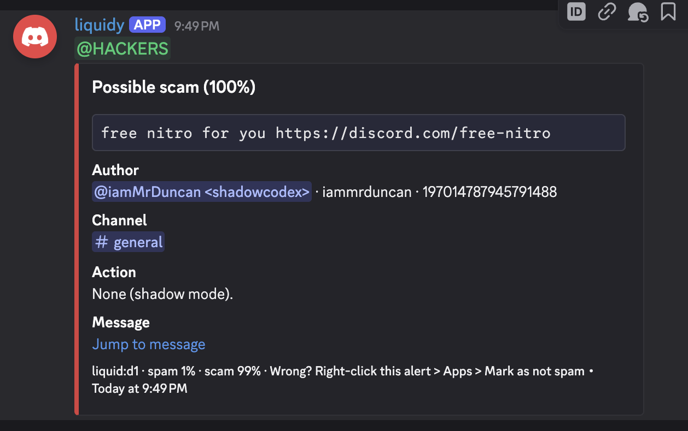

# liquidy

A Discord bot that judges every message in a server with Liquid AI's
[d1 decision model](https://docs.liquid.ai/lfm/models/d1) and acts on spam and scams.



## Modes

Set `MODE` to choose what happens when a message is flagged.

| Mode | What the bot does | Who gets pinged |
| --- | --- | --- |
| `shadow` (default) | Nothing. It posts an alert in the moderator channel. | `MOD_ROLE_ID` |
| `delete` | Deletes the message. | No one, unless the delete fails |
| `kick` | Removes the author and deletes their messages from the last 24 hours. | No one, unless the kick fails |
| `ban` | Bans the author and deletes their messages from the last 24 hours. | No one, unless the ban fails |

Every mode posts an alert to `MOD_CHANNEL_ID` when one is set. The alert shows the message text in
a code block, so its links can't be clicked, along with the author, the probabilities and what the
bot did. The moderator role is pinged at most once per author every 10 minutes.

**Kick is a softban.** Discord's kick can't delete messages, so `kick` bans the author with 24
hours of message deletion and then lifts the ban straight away. The author is out of the server
and can rejoin with an invite. The audit log, and any logging bot, shows a ban and an unban. Both
`kick` and `ban` need the **Ban Members** permission.

If the author's highest role is above the bot's, or an action fails, the bot deletes the message
if it can and pings moderators.

## How a message is judged

Each message, and each edit that changes the text, becomes one d1 **Choice** question over three
labels: `legitimate`, `spam` and `scam`. The labels and their descriptions are in
[`src/model/classifier.ts`](src/model/classifier.ts). d1 returns a probability for each label and
generates no text. The bot acts when `P(spam) + P(scam) >= FLAG_THRESHOLD` (0.8 by default).

The model sees the following state, built in [`src/context.ts`](src/context.ts):

- **Message:** the text (up to 2,000 characters), links with their parsed host (lookalike Unicode
  domains show up as `xn--` punycode), attachments, embeds and mention counts.
- **Author:** username, display name, account age, time in the server, number of roles and
  whether they have an avatar.
- **Recent activity:** the author's messages in the last 10 minutes, how many channels they used
  and how many were identical to this one. Repeating the same text across channels is the usual
  sign of a raid or a compromised account.
- **Channel:** the channel's name and topic, plus the last `CHANNEL_CONTEXT_MESSAGES` messages
  from the bot's cache. Reading them makes no API calls.
- **Server:** its name and anything you put in `SERVER_CONTEXT`, such as "Self-promotion is
  allowed in #showcase".
- **Images:** with `CLASSIFY_IMAGES=true`, up to 4 image attachments go in too. They are scaled
  to 1024 px on the longest side through Discord's media proxy.

The bot never judges:

- bots, webhooks or system messages;
- channels listed in `EXEMPT_CHANNEL_IDS` (threads inherit from their parent channel);
- roles listed in `EXEMPT_ROLE_IDS`;
- members who can already moderate (`EXEMPT_STAFF`, on by default).

## Marking messages for training

Moderators can label any message. Right-click it (long-press on mobile), open **Apps**, and pick
one of three commands:

- **Mark as spam** or **Mark as scam** for a message the bot missed.
- **Mark as not spam** for a false positive. This saves the label `legitimate`.

The bot saves the message as a labelled example in its SQLite database (`DATABASE_PATH`, by
default `data/liquidy.db`) and replies only to that moderator.

**Marking a deleted message through its alert.** In `delete`, `kick` and `ban` modes the flagged
message is already gone, so moderators mark the bot's alert about it instead. The alert's footer
says so. The bot maps the alert back to the message it flagged and saves that message, with the
state it judged. It remembers its last 1,000 alerts and forgets them when it restarts. Marking an
alert as not spam doesn't undo the bot's action. Restore the message, or lift the ban, by hand.

Each example holds:

- the label;
- the state the model saw;
- the bot's own verdict at the time, which shows what it missed;
- message, channel and author IDs;
- who marked it, and when.

The bot remembers the state and verdict of its last 2,000 judged messages. For an older message,
or one it never judged (staff, exempt channels, or sent before it started), it saves the state it
would build now and records that with `state_source = 'rebuilt'`. Marking a message again changes
its label, and keeps the state saved first.

By default, only members with **Manage Messages** see the commands. Change that under
**Server Settings > Integrations**. The bot also accepts `MOD_ROLE_ID` members once they can see
them.

To write every example as JSON Lines, ready for training or for scoring thresholds, run:

```sh
npm run -s export > examples.jsonl
```

## The model

The bot calls Liquid AI's System One decision API, `POST {LIQUID_BASE_URL}/decisions/v1/systemone`,
with the `model` (`d1` by default, or `d1-ultra`), the `state` and the `questions`. See
[A Liquid API key](#a-liquid-api-key) to get a key.

Leave `LIQUID_BASE_URL` as `https://api.liquid.ai` unless you send requests through a proxy, or
to a self-hosted d1 that serves the same route. A key is required only for Liquid's own API.

## Setup

1. Create a new application at the
   [Discord Developer Portal](https://discord.com/developers/applications) for this bot alone.
   It leaves every server except `GUILD_ID`, so don't reuse an application that is in other
   servers. Under **Bot**, turn on the **Message Content Intent**. It is privileged, and without
   it the bot can't log in.
2. Make the application private, so only you can add it to a server:
   1. **Installation > Installation Contexts:** untick **User Install** and keep **Guild Install**.
   2. **Installation > Install Link:** choose **None** and save. Discord won't make an
      application private while it has an install link.
   3. **Bot > Public Bot:** turn it off.
3. Invite the bot with the scopes `bot` and `applications.commands` (for the mark commands) and
   the permissions it needs. Once the bot is private, only you, as its owner, can use this link.
   Permissions `93188` cover View Channels, Send Messages, Embed Links, Read Message History,
   Manage Messages and Ban Members:
   `https://discord.com/oauth2/authorize?client_id=<APPLICATION_ID>&scope=bot+applications.commands&permissions=93188`
4. In **Server Settings > Roles**, drag the bot's role above the roles of the members it should
   act on. Discord won't let it kick or ban anyone at or above its own role.
5. Fill in `.env` and run. [Configuration](#configuration) says where each value comes from.

   ```sh
   cp .env.example .env    # then fill it in
   npm install
   npm run dev             # runs src/ directly, restarting on changes
   ```

At startup, the bot logs a warning for each permission the chosen mode needs but doesn't have.

To try the model without Discord, using only the model settings from `.env`, run:

```sh
npm run classify -- "Free Nitro for everyone: https://dlscord-gift.com/claim"
```

Start in `shadow` mode. Watch the alerts and the `judged` log lines (each one has
`flagProbability`) to set `FLAG_THRESHOLD`, then switch to an acting mode.

### What keeps the bot private

The Developer Portal settings in step 2 decide who can add the bot. The code also keeps it to
your server:

- **One server.** It acts only in `GUILD_ID`. It leaves any other server, both at startup and
  whenever it is added to one, and logs the server's ID and name.
- **Install check.** If **Public Bot** or **User Install** is still on, it logs a warning at
  startup.
- **Commands.** The mark commands are registered in `GUILD_ID` only. They work only in a server,
  for a server install. By default only members with Manage Messages see them.
- **No DMs.** It reads no direct messages: it doesn't request the DM intents.

## Configuration

The bot reads its settings from `.env` in the folder you start it from. Copy
[`.env.example`](.env.example) to `.env` and fill it in. A few rules:

- A blank value, such as `MOD_ROLE_ID=`, counts as unset.
- Spaces in a value need no quotes.
- Put comments on their own line, starting with `#`. Never put one after a value on the same
  line: Node's `.env` parser keeps some of those as part of the value.
- Wrap any value that contains `#` in double quotes, or it may be cut off at the `#`:
  `SERVER_CONTEXT="Self-promotion is allowed in #showcase."`

[`src/config.ts`](src/config.ts) checks every setting at startup. If one is missing or wrong,
the bot exits with a message naming it.

`.env` holds your bot token and API key. It is git-ignored: keep it out of chats, screenshots and
commits.

### The smallest `.env`

This runs `shadow` mode with d1 on Liquid's API. Everything else has a default.

```sh
# Developer Portal > your app > Bot > Reset Token
DISCORD_TOKEN=MTIz...
# Right-click your server icon > Copy Server ID
GUILD_ID=123456789012345678
# Right-click the moderators' channel > Copy Channel ID
MOD_CHANNEL_ID=234567890123456789
# Optional. Server Settings > Roles > right-click the role > Copy Role ID
MOD_ROLE_ID=345678901234567890
# console.liquid.ai > Dashboard > API Keys
LIQUID_API_KEY=liquid_...
```

### Where to find each value

#### Discord IDs

`GUILD_ID`, `MOD_CHANNEL_ID`, `MOD_ROLE_ID`, `EXEMPT_ROLE_IDS` and `EXEMPT_CHANNEL_IDS` are
Discord IDs: numbers 17 to 20 digits long. To copy them:

1. Turn on Developer Mode, under **User Settings > Advanced > Developer Mode**. This adds
   **Copy ID** to Discord's right-click menus. On mobile, long-press instead of right-clicking.
2. Copy the ID you need:
   - **Server:** right-click the server icon, then **Copy Server ID**.
   - **Channel:** right-click the channel, then **Copy Channel ID**.
   - **Role:** open **Server Settings > Roles**, right-click the role, then **Copy Role ID**.

#### The bot token

`DISCORD_TOKEN` is the password the bot logs in with.

1. Open the [Developer Portal](https://discord.com/developers/applications) and select your
   application.
2. Under **Bot**, choose **Reset Token**, then copy the token. Discord shows it only once.
3. If the token leaks, reset it again; the old one stops working.

The invite link in [Setup](#setup) needs a different value, the **Application ID**. It is under
**General Information** and is not secret.

#### A Liquid API key

`LIQUID_API_KEY` lets the bot call d1.

1. Sign in at [console.liquid.ai](https://console.liquid.ai) and join or create an organization.
2. Under **Dashboard > API Keys**, create a key. It starts with `liquid_`.

### Every setting

#### Discord

| Setting | Default | Meaning |
| --- | --- | --- |
| `DISCORD_TOKEN` | required | The bot's login token. See [The bot token](#the-bot-token). |
| `GUILD_ID` | required | The one server the bot watches. It leaves every other server. |
| `MODE` | `shadow` | What happens to a flagged message: `shadow`, `delete`, `kick` or `ban`. See [Modes](#modes). |
| `MOD_CHANNEL_ID` | required in `shadow` | Where alerts go. Optional in the other modes, but without it nobody hears what the bot did. |
| `MOD_ROLE_ID` | none | The role pinged in `shadow` mode, and whenever an action fails. Members with it can also use the mark commands, once **Server Settings > Integrations** shows the commands to that role. |

#### Judging

| Setting | Default | Meaning |
| --- | --- | --- |
| `FLAG_THRESHOLD` | `0.8` | From 0 to 1. The bot acts when P(spam) + P(scam) reaches this. Lower catches more and has more false positives; higher misses more. |
| `EXEMPT_ROLE_IDS` | none | Comma-separated role IDs whose members are never judged, such as trusted regulars. |
| `EXEMPT_CHANNEL_IDS` | none | Comma-separated channel IDs that are never judged. Threads inherit from their parent channel. |
| `EXEMPT_STAFF` | `true` | Skip members who can already moderate: Administrator, Manage Messages, Timeout Members, Kick Members or Ban Members. Set it to `false` to test the bot on your own messages. |
| `SERVER_CONTEXT` | none | Free text the model reads with every message, describing what is normal here, such as `"We trade Pokémon cards; trade offers are allowed."`. Quote it if it contains `#`. |
| `CHANNEL_CONTEXT_MESSAGES` | `5` | From 0 to 20. How many earlier messages in the channel the model sees as context. These are other members' messages, sent to Liquid AI; `0` sends none. |
| `CLASSIFY_IMAGES` | `false` | Send image attachments (JPEG, PNG, WebP, GIF; up to 4 per message) to the model too. Costs more input tokens. |
| `MAX_CONCURRENCY` | `4` | How many model calls run at once; the rest wait in a queue. Raise it if raids back up, and lower it if Liquid rate-limits you. |

#### Storage and logs

| Setting | Default | Meaning |
| --- | --- | --- |
| `DATABASE_PATH` | `data/liquidy.db` | The SQLite file for marked messages, relative to the folder you start the bot from. Created, with its folder, on first use. |
| `LOG_LEVEL` | `info` | `debug`, `info`, `warn` or `error`. `debug` also logs every message the bot skips, and why. See [Troubleshooting](#troubleshooting). |

#### Model

| Setting | Default | Meaning |
| --- | --- | --- |
| `MODEL` | `d1` | `d1`, or `d1-ultra`, which is more capable and costs more. See [The model](#the-model). |
| `MODEL_TIMEOUT_MS` | `10000` | How long to wait for the model, and for each image download, before giving up on a message. A message that times out is logged and not acted on. |
| `LIQUID_API_KEY` | required | See [A Liquid API key](#a-liquid-api-key). Not needed if `LIQUID_BASE_URL` points somewhere that needs no key. |
| `LIQUID_BASE_URL` | `https://api.liquid.ai` | Where System One requests go. Change it only for a proxy, or a self-hosted d1. |

## Troubleshooting

The bot logs one JSON line per event to the terminal it runs in. After startup, look for a line
with `"msg":"watching"`; if it is missing, an error line above it says why the bot stopped.

### I sent a message and nothing was logged

**You are probably exempt as staff.** With `EXEMPT_STAFF=true` (the default), the bot never
judges messages from the server owner, or from anyone with Administrator, Manage Messages, Timeout
Members, Kick Members or Ban Members. A notice at startup says so. To test, either:

- set `EXEMPT_STAFF=false` in `.env` (`npm run dev` restarts the bot when you save); or
- post from a second account that has none of those permissions.

**To see why a message was skipped,** set `LOG_LEVEL=debug` and restart. Then every message the
bot receives produces one line:

| Line | Meaning |
| --- | --- |
| `"msg":"judged"` | The model judged it; `flagProbability` is P(spam) + P(scam). |
| `"msg":"skipped"` | Not judged. `reason` says why: staff, an exempt role or channel, a bot or webhook, a system message, an author just removed, or no text or attachments. |
| `"msg":"judging a message failed"` | The model call failed, for example a bad API key or a timeout. `error` has the details. |

If a message produces none of these, Discord never delivered it to the bot. Check that the bot's
role can **View Channel** in that channel, and that the message was in `GUILD_ID`.

Changes to `.env` take effect when the bot restarts. `npm run dev` restarts it on its own
whenever `.env` or the code changes. With `npm start`, stop the bot and start it again.

## Development

Requires Node.js 22.15 or later. `npm run dev`, `npm test` and `npm run classify` run the
TypeScript directly with Node's type stripping.

| Command | |
| --- | --- |
| `npm run check` | Typecheck, lint (Biome) and test |
| `npm test` | Unit tests (`node:test`); the Liquid client is tested against a local HTTP stub |
| `npm run build` / `npm start` | Compile to `dist/` and run the compiled bot |
| `npm run -s export` | Print the marked examples as JSON Lines |

## Data and privacy

Every message the bot judges goes to Liquid AI, along with the author details and
recent channel messages described above. Set `CHANNEL_CONTEXT_MESSAGES=0` to send only the
message being judged. Logs record message, channel and author IDs and verdicts, never message
text.

The database keeps every marked message, including its text, the author's ID and the recent
channel messages in its state, until you delete it. Treat `data/` as moderation records: it is
git-ignored, and it is yours to back up and to prune.

## Limits of this version

- **Single server.** The bot watches only `GUILD_ID`, and all settings are global.
- **History resets on restart.** The per-author activity window is kept in memory, so it starts
  empty each time the bot restarts.
- **Recent edits only.** Edits are judged only for messages still in discord.js's cache (the
  last 200 per channel).
- **No retries.** A failed model call is logged and no action is taken on that message.
- **No buttons.** Moderators act on shadow-mode alerts by hand.
- **Alerts are forgotten on restart.** After a restart, an older alert can't be marked. Only
  examples already saved are kept.
- **No images in examples.** Examples keep attachment names and types, not the images. Discord's
  attachment links expire.
